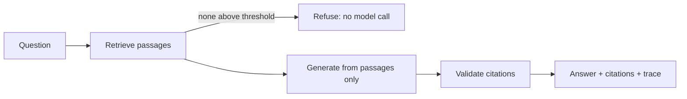

# Micro-RAG Knowledge Engine: concept and architecture

A small retrieval-augmented generation (RAG) pipeline designed around one rule: **an answer must show its work, and when the documents don't contain the answer, it must say so.**

This repository is the public concept and architecture write-up for the project. It contains documentation only. The implementation is not published here.

| | |
|---|---|
| **Try it** | [rag.ruelabion.com](https://rag.ruelabion.com), a browser-only edition that runs on five sample documents |
| **Author** | [Ruel T. Abion](https://ruelabion.com), independent AI and cloud systems architect |
| **Code** | Available on request. See [Requesting the code](#requesting-the-code) |

## What it does

1. **Ingests** documents into passages and stores an embedding for each.
2. **Retrieves** the passages most similar to a question, above a minimum score.
3. **Refuses** before calling any model if nothing is relevant enough.
4. **Generates** an answer from only the retrieved passages, with numbered citations `[1]`, `[2]`.
5. **Validates** the citations: only markers that point at passages actually supplied are kept, and an answer with no valid citation is flagged as unverified.
6. **Traces** every stage (scores, timings, dropped citations) so a bad answer can be attributed to retrieval or generation.

## The browser demo

[rag.ruelabion.com](https://rag.ruelabion.com) runs the whole pipeline in your browser: no server, database or language model, and your question is not sent anywhere. It uses an offline keyword retriever and an extractive generator that quotes passages, and every citation links to the full source document so you can check it yourself. It demonstrates the pipeline's behaviour (retrieve, cite, refuse), not semantic search or language-model quality.

## Documentation

- [Architecture and design decisions](docs/ARCHITECTURE.md): stages, boundaries, and why each decision was made
- [Walkthrough](docs/WALKTHROUGH.md): how the pattern works, step by step, with the rules to implement
- [What this does and doesn't prove](docs/LIMITATIONS.md): honest limits and what production use would add

## Implementation at a glance

| Area | Choice |
|---|---|
| Application | Next.js and Node.js, with the pipeline in a framework-independent core |
| Vector store | Postgres with pgvector (HNSW, cosine); an in-memory store for tests and the browser demo |
| Embeddings | Any OpenAI-compatible endpoint, or an offline lexical embedder for tests |
| Generation | Anthropic Claude API over plain `fetch`, or an offline extractive generator |
| Testing | Offline test suite and a labelled question set that gate retrieval quality |

The implementation has been exercised against a real pgvector database. The live Claude request shape is covered by tests against a stubbed `fetch`; it has not been load-tested against the live API.

## Requesting the code

The source is kept private for now. If you would like to see the code behind the demo, request it through the contact form at **[ruelabion.com/#assessment](https://ruelabion.com/#assessment)**. Mention "Micro-RAG code" and say briefly who you are and what you want to use it for. Replies come from [Ruel Abion](https://ruelabion.com) directly.

If you are weighing a retrieval or grounded-AI design for your own organization, the same form is the way to ask for an architecture assessment.

## About this repository

Documentation © 2026 Ruel T. Abion. All rights reserved. You may quote and link to it with attribution. The software it describes is not included or licensed by this repository.
